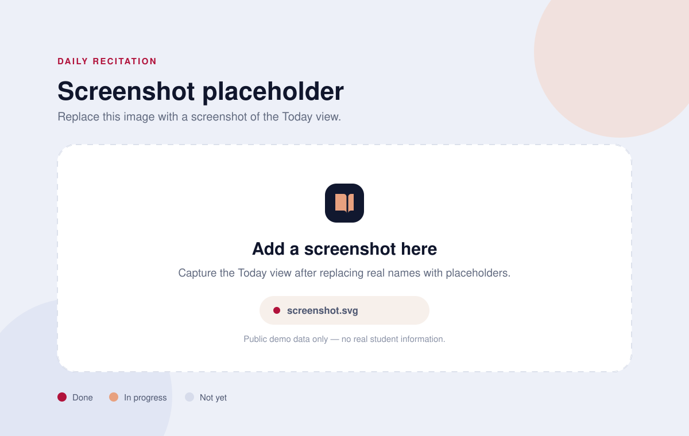

# Daily Recitation

A small, self-contained web app for tracking daily Qur'an recitation (setoran) for a class. It shows each student's progress through a fixed list of units, lets you record a status in one tap, and keeps a seven-day activity chart. The whole app is a single HTML file with no build step, no backend, and no account.

> **Privacy note:** this public copy ships with placeholder names (`Student 1` … `Student 8`). Do **not** publish real student names, IDs, contact details, or any other personal information. See [Publishing checklist](#publishing-checklist).

## Screenshot



*Screenshot placeholder — replace `screenshot.svg` with a current screenshot of the Today view before publishing.*

## Run it

From this folder:

```bash
python3 -m http.server 8080
```

Then open <http://localhost:8080> in a browser. Press `Ctrl+C` in the terminal to stop the server.

Any static file server works. Opening `index.html` directly from disk also works because the app makes no network requests, but serving it over HTTP gives you a stable origin for saved progress.

## What it does

- **Today** — shows every student's current status and lets you record today's recitation as *Done*, *In progress*, or *Not yet*.
- **Progress** — shows class completion, per-student unit counts, and a **Copy CSV** button for pasting the current table into a spreadsheet.
- **Students** — shows the roster and a per-student unit checklist; changes save immediately.
- **Last 7 days** — a small chart of status updates recorded during the week.

## Where the data lives

Progress is stored **only in this browser**, in `localStorage` under the key `daily-recitation.v1` for the page's origin. There is no server, no account, and no analytics. Nothing is uploaded.

- Clearing the browser's site data resets the app to its initial snapshot.
- `http://localhost:8080` and `http://localhost:3000` are different origins, so they do not share progress.
- Private/incognito windows usually discard progress when the window closes.
- Use **Progress → Copy CSV** to export the current state.

## Editing data.json

`data.json` is the readable master copy of the units and students. It has this shape:

```json
{
  "units": [
    { "id": "al-bayyinah-v2", "label": "AL BAYYINAH" },
    { "id": "Yasin 1 sayfa", "label": "Yasin 1 sayfa", "table": 1 }
  ],
  "students": [
    {
      "id": 1,
      "name": "Student 1",
      "units": {
        "al-bayyinah-v2": "todo",
        "Yasin 1 sayfa": "progress"
      }
    }
  ]
}
```

The app also keeps import metadata and computed counts in this file. You normally do not need to touch those; edit `units` and `students`.

### Units

- Each unit needs a unique, stable `id` and a human-readable `label`.
- The optional `table` field is historical metadata and is ignored by the interface.
- To add a unit, add it to `units` **and** add its `id` to every student's `units` object (use `"todo"` as the starting value).
- To remove a unit, remove it from both places. Removing a unit does not delete its entry from an existing browser snapshot, but the app ignores unknown unit IDs.
- Changing a unit's `id` starts that unit from scratch for everyone, because saved progress is keyed by `id`. Change only the `label` if you just want to rename it.

### Students

- Each student needs a unique `id`, a `name`, and a `units` object.
- Keep an existing `id` when you rename a student; that is how their saved progress stays attached.
- A missing status is treated as `"todo"`. Valid statuses are `"todo"`, `"progress"`, and `"done"`.
- Add a student by appending an object with the next unused `id` and a `units` map containing every unit. Remove a student by deleting their object.

Validate the JSON after editing:

```bash
python3 -m json.tool data.json > /dev/null && echo "valid JSON"
```

### Sync the embedded snapshot

The app does not fetch `data.json` at runtime. To keep the page self-contained, `index.html` embeds a copy of the data in the `<script id="seed" type="application/json">` element. After editing `data.json`, run this from the project folder to update that snapshot:

```bash
python3 - <<'PY'
import json, re
from pathlib import Path

data = json.loads(Path("data.json").read_text(encoding="utf-8"))
html = Path("index.html").read_text(encoding="utf-8")
compact = json.dumps(data, ensure_ascii=False, separators=(",", ":"))

html, count = re.subn(
    r'(<script id="seed" type="application/json">).*?(</script>)',
    lambda m: m.group(1) + compact + m.group(2),
    html,
    count=1,
    flags=re.S,
)
if count != 1:
    raise SystemExit("embedded seed element not found")

Path("index.html").write_text(html, encoding="utf-8")
print("Embedded snapshot updated. Reload the page.")
PY
```

Then reload the page. If progress still looks like the old data, clear `localStorage` for the site (DevTools → Application → Local Storage → delete `daily-recitation.v1`).

## Customize

### Change student names

1. Edit the `name` value for each student in `data.json`. Keep the `id` unchanged to preserve their progress.
2. Run the **Sync the embedded snapshot** command above.
3. Reload the page.

### Change units

1. Edit the `units` array and each student's `units` map in `data.json` as described above.
2. Run the **Sync the embedded snapshot** command above.
3. Reload the page and clear the old `localStorage` entry if you want a clean start.

### Change the title and colors

The visible title, tab labels, and colors are in `index.html`. The color tokens are CSS custom properties at the top of the `<style>` block (`--bg`, `--crimson`, `--peach`, `--navy`, and so on). The document title is set in the `<title>` tag and in the small `document.title` calls in the script.

## Publishing checklist

- [ ] Replace every real student name with a placeholder in **both** `data.json` and the embedded snapshot in `index.html`.
- [ ] Search the folder for real names and any other personal data before pushing.
- [ ] Keep spreadsheets, backups, screenshots with real names, and private dumps out of the repository (`.gitignore` covers common cases).
- [ ] Publish only anonymised or synthetic progress data.

**The data must not contain real personal information when published.**

## License

MIT — see [LICENSE](LICENSE).
